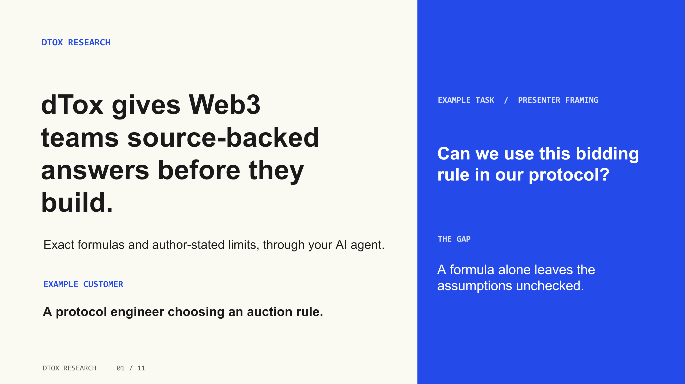

<p align="center">
  
</p>

# dtox research

**Give your AI agent a research library it can actually read.**

dtox helps Web3 builders and AI agents investigate engineering ideas against research papers, protocol specifications and technical documents. Find relevant work, inspect the original methods and assumptions, retrieve equations and algorithms, and connect a design decision to its supporting sources.

[Live project](https://read.whoim.space/research/) · [Free MCP endpoint](https://read.whoim.space/mcp) · [Developer guide](docs/technical-reference.md)

**183,856 indexed document records · 11,085,974 indexed passages · 3,399,205 citation links · 13 public MCP tools**

Observed **17 October 2026, 14:01 UTC**. Records include papers and specifications; available full text and structured elements are identified in each response.

## The problem

A protocol engineer choosing an auction mechanism, a wallet team reviewing account abstraction, and an agent researching data availability all face the same problem: the relevant knowledge is scattered across papers, specifications and technical documents.

An abstract can identify a promising approach. The implementation decision often depends on something deeper: an equation, a security assumption, an experimental result, or a limitation stated several sections later. Agents need a way to find that evidence and bring the source back into the conversation.

## What dtox delivers

A hosted research workflow inside the agent's existing MCP client:

- **Discover relevant work.** Search papers and protocol specifications by an engineering question, then explore related documents and citation links.
- **Read the source.** Open a paper's outline and retrieve the method, assumptions, results or limitations that matter to the decision.
- **Retrieve technical detail.** Request indexed equations, algorithms, code and tables as structured evidence, including original LaTeX where available.
- **Compare approaches.** Inspect evidence from two methods and assemble a bounded research packet with citations and source metadata.
- **Investigate an idea.** Pass its technical claims to `validate_project`, inspect the returned candidate sources, and read what those sources actually establish.
- **Attribute a reading.** Prepare a canonical verdict message, sign it with an agent's wallet, and record the reading through Solana SAS on devnet.

The result is a trail from an engineering question to a source passage and an explicit reading of that evidence.

## Try it in three minutes

The public research endpoint is free to connect. No signup, API key or wallet is needed for research reads.

```bash
# Codex
codex mcp add dtox --url https://read.whoim.space/mcp

# Claude Code
claude mcp add --transport http dtox https://read.whoim.space/mcp
```

For other HTTP MCP clients:

```json
{
  "mcpServers": {
    "dtox": {
      "type": "http",
      "url": "https://read.whoim.space/mcp"
    }
  }
}
```

Use your client's HTTP MCP configuration format. The [project page](https://read.whoim.space/research/) provides connection details; the tools run inside the connected agent.

### A quick judging walkthrough

Ask your connected agent:

> Find research on data availability sampling for blockchain light clients with limited bandwidth. Open a relevant paper, read its method and assumptions, and explain the implementation trade-offs with source citations. Distinguish the authors' findings from your own conclusions.

A typical tool sequence is:

1. `find_papers` or `search_research_paper` to discover sources.
2. `get_paper` to inspect a selected document and its outline.
3. `read_paper_section` to read the relevant method or assumptions.
4. `get_code_or_math_spec` when the argument depends on an equation, algorithm or table.
5. `get_research_bundle` to collect a bounded evidence packet, or `compare_methods` to investigate two approaches.

For a reproducible starting point, open `2005.11401` with `get_paper`, then read its `Introduction` using `read_paper_section`. This is *Retrieval-Augmented Generation for Knowledge-Intensive NLP Tasks*; its card, outline and section read were checked through the public MCP on 17 October 2026.

For a protocol engineering example, follow the [Web3 case: what a blob commitment actually proves](docs/web3-case-study.md). It traces a live-checked question through EIP-4844's networking, proof and availability boundaries, with the source passages needed to assess the conclusion.

To try claim-oriented research:

> Use validate_project to investigate a retrieval-augmented language model. Evaluate this claim separately: “Retrieval augmented generation conditions language-model answers on retrieved documents.” Show the candidate papers and supporting passages, then explain what still needs verification.

Judge the output by the relevance of the retrieved sources, the passages available to inspect, and how clearly the agent connects each conclusion to its evidence. [Detailed research workflow](docs/agent-research-workflow.md).

## Why Web3 builders

The corpus brings research and implementation specifications into the same workflow:

| Engineering question | Useful evidence |
| --- | --- |
| How should a light client sample data? | Availability proofs, coding assumptions and protocol trade-offs |
| Which trust boundaries matter for account abstraction? | EIP/ERC specification text and security considerations |
| Can an auction mechanism fit a protocol's incentives? | The original equations, participant model and assumptions |
| How should an agent retrieve and verify technical knowledge? | Retrieval methods, evaluation results and reported limitations |

Sources include arXiv, IACR ePrint, ACL Anthology, PMLR, open-access research, Ethereum EIPs/ERCs, Solana SIMDs and technical whitepapers. Four indexed layers connect Web3 with adjacent work in AI agents, language models and builder technology.

## Why Solana

Research discovery, payment and attribution serve different parts of the agent workflow.

**Wallet-attributed readings through SAS.** An agent signs a canonical message containing the claim, paper ID and verdict. The attestor verifies the reviewer's signature and records a Solana Attestation Service attestation containing the reading and reviewer identity. This makes the attributed statement inspectable beyond the API response. A signature establishes who signed the reading; evaluating the evidence remains a research task.

```text
Read source evidence
        |
get_verdict_message -> agent wallet signs -> record_signed_verdict
                                                    |
                                           signature verification
                                                    |
                                       Solana SAS attestation
```

**Agent payments through x402.** A separate MCP gateway implements per-call USDC payments for research tools and signed readings. The free research endpoint remains available alongside this integration.

The Solana integration targets **devnet**. See the [attestor](attestor/README.md) and [x402 gateway](x402-gateway/README.md) for the signing flow, payment configuration and network details.

## How it works

```text
Papers · EIPs/ERCs · Solana SIMDs · technical documents
                           |
             acquire originals and source metadata
                           |
              parse sections and structured elements
                           |
         +-----------------+------------------+
         |                 |                  |
    Paper vectors     Passage vectors     SQLite FTS5
      (768D)             (384D)           + citation graph
         |                 |                  |
         +-----------------+------------------+
                           |
          hierarchical retrieval and rank fusion
                           |
                 FastAPI research API
                           |
                    public MCP tools
                           |
                  AI agents and builders
```

Paper-level retrieval shortlists documents before passage-level retrieval searches their contents. Dense retrieval captures semantic relevance; lexical retrieval preserves exact technical terms. Citation neighbours provide another route to related work. The API combines these channels and returns source identifiers, passage text and coverage metadata.

The ingestion pipeline stores acquired originals and builds document sections, structured elements and search projections. Document publication updates the vector index, lexical index and caches through a journalled replacement workflow.

**Stack:** Python · FastAPI · FastMCP · Qdrant · SQLite FTS5 · ONNX embeddings · PyMuPDF4LLM · LaTeX parsing · TypeScript · Solana SAS · x402.

## Public tool catalog

| Tool | What a judge or builder can inspect |
| --- | --- |
| `find_papers` | Relevant papers and specifications, with sorting and filters |
| `search_research_paper` | Indexed passages for a natural-language question |
| `get_paper` | A document card, outline and citation links |
| `read_paper_section` | Text from a selected source section |
| `count_papers` | Corpus counts and topic facets within the requested scope |
| `similar_papers` | Related documents through semantic retrieval |
| `get_code_or_math_spec` | Indexed equations, algorithms, code and tables |
| `compare_methods` | Evidence for comparing two documents |
| `research_trends` | Topic and publication trends |
| `validate_project` | Candidate research evidence for distinct technical claims |
| `get_research_bundle` | A bounded packet of source evidence |
| `get_verdict_message` | A canonical message for a wallet-signed reading |
| `record_signed_verdict` | Submission of the caller's signed reading |

MCP discovery supplies the full argument schemas. Source and coverage fields distinguish available full text from abstract-only records; retrieval matches are candidates for inspection. [Tool details and self-hosting](docs/technical-reference.md).

## Build with dtox

The repository contains the research API and MCP server, ingestion and publication pipeline, embedding services, attestor and payment gateway.

| Component | Source |
| --- | --- |
| Research API and retrieval | [api/](api/) |
| Public MCP tools | [mcp/](mcp/) |
| Source ingestion and publication | [pipeline/](pipeline/) |
| Embedding services | [embed/](embed/) |
| Wallet signatures and SAS | [attestor/](attestor/) |
| Paid MCP gateway | [x402-gateway/](x402-gateway/) |
| Evaluation tools | [eval/](eval/) |

- [Developer guide: setup, configuration and checks](docs/technical-reference.md)
- [Agent research workflow](docs/agent-research-workflow.md)
- [Security reporting](SECURITY.md)
- [GNU AGPL-3.0 license](LICENSE)

## Founder

Built by **Daniyar Gabdullin**, solo founder and mobile/Web3 engineer.

[Portfolio](https://portfolio.whoim.space/) · [LinkedIn](https://www.linkedin.com/in/daniyar-gabdullin-11312b252/)
